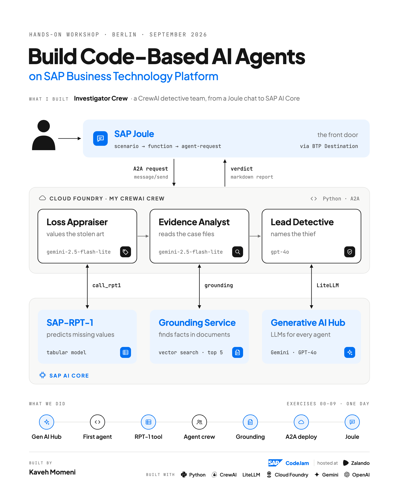
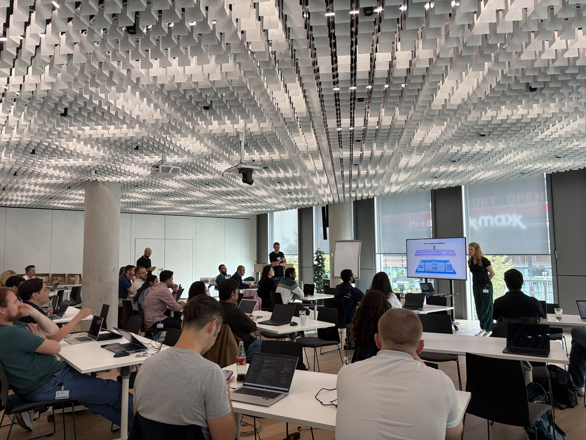

# Investigator Crew — Multi-Agent AI on SAP BTP

[](https://www.python.org/)
[](https://www.crewai.com/)
[](https://www.sap.com/products/technology-platform.html)
[](https://www.sap.com/products/artificial-intelligence/joule.html)
[-1D4F91)](https://github.com/google/A2A)
[](LICENSE)

> **A multi-agent CrewAI detective system built on SAP Business Technology Platform (SAP BTP)** — combining **SAP-RPT-1** for tabular valuation, **SAP Document Grounding Service** for RAG over case files, and **Generative AI Hub** (`Gemini 2.5 Flash-Lite` & `GPT-4o`) for multi-step reasoning, exposed via the **Agent-to-Agent (A2A)** protocol on **Cloud Foundry** and invoked directly from **SAP Joule**.
>
> 🔗 **Featured in my LinkedIn Post:** [Read the story from SAP CodeJam Berlin (hosted at Zalando)](https://lnkd.in/p/dFJtP_is) · [Full Post & Notes](docs/LINKEDIN_POST.md)



---

## 🎨 The Scenario: Solving a Gallery Art Heist

Fourteen priceless artworks and jewels have vanished from a gallery overnight—no forced entry, disabled cameras, and three prime suspects (`Sophie Dubois`, `Marcus Chen`, and `Viktor Petrov`). Five cells in the insurance ledger are missing (`[PREDICT]`), and the clues are scattered across eight internal evidence documents (security logs, bank records, phone logs, loan documents, termination letters, and criminal records).

Instead of asking a single monolithic LLM to guess numbers and read everything at once, **Investigator Crew** coordinates a sequential team of specialized agents:

| Order | Agent | Model (via Gen AI Hub) | Tool | Responsibility |
| :---: | :--- | :--- | :--- | :--- |
| **1** | 💰 **Loss Appraiser** (`appraiser_agent`) | `sap/gemini-2.5-flash-lite` | `call_rpt1` | Sends the 14-item inventory payload (`payload.py`) to **SAP-RPT-1** (`sap-rpt-1-large`) to predict missing `INSURANCE_VALUE` (regression) and `ITEM_CATEGORY` (classification) cells. Never guesses numbers. |
| **2** | 🔎 **Evidence Analyst** (`evidence_analyst_agent`) | `sap/gemini-2.5-flash-lite` | `call_grounding_service` | Queries the **SAP Document Grounding Service** vector pipeline (top 5 chunks per suspect) over the 8 case files in `data/documents/`. Never fabricates alibis or facts. |
| **3** | *(Optional)* 🌐 **OSINT Researcher** (`intelligence_researcher_agent`) | `sap/gpt-4o` | `call_sonar_pro_search` | *(Available via `--with-osint`)* Uses Perplexity's `sap/sonar-pro` on Generative AI Hub to search for connected art heists and criminal network patterns. |
| **4** | 🧠 **Lead Detective** (`lead_detective_agent`) | `sap/gpt-4o` | *(None — pure synthesis)* | Synthesizes the appraisal report and grounded evidence report, cross-checks alibis, motives, and financial records, sums the total insurance loss across all 14 items, and names the culprit. |

---

## 🏗️ System Architecture

The code in this repository implements the **A2A Server** (`server.py`), the **CrewAI Orchestration** (`investigator_crew.py`, `config/*.yaml`), and the **SAP Joule Capability** (`joule/`). Everything else runs as managed SAP BTP services.



### End-to-End Request Sequence (Joule → A2A → CrewAI → SAP AI Core)

When a business user asks **SAP Joule** to investigate the heist, Joule resolves the BTP Destination, discovers the agent via `GET /.well-known/agent-card.json`, and sends a single JSON-RPC 2.0 `message/send` call.



👉 For a deep dive into the **7-layer stack**, **JSON-RPC / RPT-1 / Grounding contracts**, and **design decisions**, see **[`docs/INTERNALS.md`](docs/INTERNALS.md)**.

---

## 📊 What the Agents Work With

### 1. Tabular Data → `SAP-RPT-1` (`payload.py`)

`payload.py` defines 14 stolen items with a strict schema (`numeric`, `string`, `date`, and `1..10` scores for condition, rarity, and provenance). Five entries are marked `[PREDICT]`:

| `ITEM_ID` | `ITEM_NAME` | `ARTIST` | `INSURANCE_VALUE` | `ITEM_CATEGORY` |
| :--- | :--- | :--- | ---: | :--- |
| `ART_001` | Water Lilies - Series 1 | Claude Monet | `45,000,000` | Painting |
| `ART_003` | Irises | Vincent van Gogh | **`[PREDICT]`** | Painting |
| `ART_007` | Girl with a Pearl Earring | Johannes Vermeer | **`[PREDICT]`** | Painting |
| `ART_009` | The Persistence of Memory | Salvador Dalí | `35,000,000` | **`[PREDICT]`** |
| `ART_012` | The Thinker | Auguste Rodin | **`[PREDICT]`** | Sculpture |
| *... + 9 more* | *(See [`payload.py`](payload.py) for full 14-item dataset)* | | | |

### 2. Unstructured Case Files → `Grounding Service` (`data/documents/`)

All 8 plain-text evidence files used to populate the vector grounding pipeline are included in [`data/documents/`](data/documents/):

- [`SECURITY_LOG.txt`](data/documents/SECURITY_LOG.txt) — Badge access, camera overrides, and vault entry timestamps
- [`BANK_RECORDS.txt`](data/documents/BANK_RECORDS.txt) — Wire transfers and suspicious financial activity
- [`PHONE_RECORDS.txt`](data/documents/PHONE_RECORDS.txt) — Burner phones and encrypted call logs around the heist window
- [`SOPHIE_LOAN_DOCUMENTS.txt`](data/documents/SOPHIE_LOAN_DOCUMENTS.txt) — High-interest debt and collateral records
- [`MARCUS_TERMINATION_LETTER.txt`](data/documents/MARCUS_TERMINATION_LETTER.txt) & [`MARCUS_EXIT_LOG.txt`](data/documents/MARCUS_EXIT_LOG.txt) — Employment dispute and building exit logs
- [`VIKTOR_CRIMINAL_RECORD.txt`](data/documents/VIKTOR_CRIMINAL_RECORD.txt) — Prior European museum theft investigations
- [`STOLEN_ITEMS_INVENTORY.txt`](data/documents/STOLEN_ITEMS_INVENTORY.txt) — Curatorial notes on the stolen collection

---

## 🚀 Quickstart

### 1. Clone & Install

```bash
git clone https://github.com/kvmmn/_sapcodejam.git
cd _sapcodejam

python3 -m venv .venv
source .venv/bin/activate
pip install -r requirements.txt
```

### 2. Configure Environment Variables

```bash
cp .env.example .env
# Edit .env with your SAP AI Core service key credentials, RPT1_DEPLOYMENT_URL, and GROUNDING_PIPELINE_ID
```

### 3. Run the Crew Locally (CLI)

```bash
# Standard 3-agent run (uses SAP-RPT-1 + SAP Document Grounding Service + Gen AI Hub)
python main.py

# Test without a Vector Grounding Pipeline (searches local ./data/documents/*.txt directly)
python main.py --local-evidence

# Run the 4-agent variant (adds OSINT Researcher with Perplexity sap/sonar-pro)
python main.py --with-osint

# Run only the single-agent Loss Appraiser starter (Exercises 02-03)
python basic_agent.py
```

### 4. Run as an A2A Server (`FastAPI` + `a2a-sdk`)

```bash
python server.py
```

Verify the agent card and health check:

```bash
curl http://localhost:8080/health
curl http://localhost:8080/.well-known/agent-card.json
```

### 5. Deploy to Cloud Foundry & SAP Joule

```bash
# Deploy the A2A server to SAP BTP Cloud Foundry
cf push

# Deploy the Digital Assistant capability to SAP Joule
cd joule
joule deploy -c -n <your_assistant_name>
```

👉 See **[`docs/DEPLOYMENT.md`](docs/DEPLOYMENT.md)** for the full step-by-step cloud deployment and Joule configuration runbook.

---

## 📁 Repository Structure

```text
.
├── main.py                         # CLI entry point (--suspects, --with-osint, --local-evidence)
├── investigator_crew.py            # @CrewBase 3-agent sequential crew + RPT-1 & Grounding @tools
├── server.py                       # FastAPI A2A server (/.well-known/agent-card.json + message/send)
├── payload.py                      # 14-item stolen art table with [PREDICT] placeholders for SAP-RPT-1
├── basic_agent.py                  # Single-agent Loss Appraiser starter (Exercises 02 & 03)
├── config/
│   ├── agents.yaml                 # Role, goal, backstory & LLM per agent ("Do NOT fabricate...")
│   └── tasks.yaml                  # Sequential task definitions & context hand-offs
├── joule/
│   ├── da.sapdas.yaml              # SAP Joule Digital Assistant descriptor
│   └── investigator_capability/    # Capability, scenario, and remote agent-request function
├── variants/
│   └── with-osint-researcher/      # 4-agent variant adding Perplexity sonar-pro OSINT Researcher
├── data/
│   └── documents/                  # 8 case evidence text files for SAP Grounding Service
├── assets/                         # Architecture diagrams (PNG & standalone vector SVGs) + event photo
├── docs/
│   ├── INTERNALS.md                # 7-layer stack, sequence diagram, contracts & design decisions
│   ├── DEPLOYMENT.md               # Step-by-step local, Cloud Foundry & SAP Joule deployment guide
│   ├── LINKEDIN_POST.md            # Original LinkedIn post & workshop reflections
│   └── visuals/                    # Interactive HTML architecture sheets (light/dark mode)
├── manifest.yml                    # Cloud Foundry deployment manifest (bound to generative-ai-hub)
├── requirements.txt                # Python dependencies (crewai[a2a], a2a-sdk, litellm, sap-ai-sdk-gen)
├── runtime.txt                     # Cloud Foundry Python buildpack runtime version (3.13.11)
└── .env.example                    # Template for SAP AI Core, RPT-1, and Grounding configuration
```

---

## 💡 Key Takeaways from SAP CodeJam Berlin

1. **An agent is only as trustworthy as the data it is forced to use.** Explicitly instructing agents to *"never guess"* or *"never fabricate evidence"* belongs in every production prompt (`config/agents.yaml`).
2. **A few focused agents outperform one monolithic agent.** Separating numeric valuation (`Loss Appraiser`), document retrieval (`Evidence Analyst`), and final synthesis (`Lead Detective`) keeps context clean and verifiable.
3. **Pick the right model for each job.** Use **SAP-RPT-1** for tabular regression/classification, fast models (`gemini-2.5-flash-lite`) for tool calling, and frontier reasoning models (`gpt-4o`) for final synthesis.
4. **Bring your own framework, let SAP Joule be the front door.** By exposing the crew over the standard **A2A protocol**, SAP Joule can discover and invoke custom code-based agents running on Cloud Foundry without coupling to the internal agent framework.



---

## 🙏 Acknowledgments

Built during the **SAP CodeJam: "Build Code-Based AI Agents on SAP Business Technology Platform"** in Berlin, hosted at **Zalando**.

- Special thanks to **[Witalij Rudnicki](https://www.linkedin.com/in/witalij/)** and **[Nora von Thenen](https://www.linkedin.com/in/nora-von-thenen/)** for designing and leading an outstanding hands-on workshop.
- Official workshop repository & exercises: **[SAP-samples/codejam-code-based-agents](https://github.com/SAP-samples/codejam-code-based-agents)**

---

## 📄 License

Licensed under the [Apache License 2.0](LICENSE).
