# Investigator Crew — Technical Internals & Contracts

This document explains the seven architectural layers, the end-to-end request lifecycle, the four declarative boundary contracts, and the core engineering decisions behind **Investigator Crew** on **SAP Business Technology Platform (SAP BTP)**.

---

## 1. Seven Layers, Top to Bottom

Each layer only knows the layer immediately below it. **SAP Joule** never sees **CrewAI**, and the **CrewAI** agents never see **Joule**.

| Layer | Component | Responsibilities & Artifacts |
| :--- | :--- | :--- |
| **1. Experience** | **SAP Joule** | Routes user intent via `investigate_scenario` → `investigate_function` → `agent-request (remote)` → alias `INVESTIGATOR_AGENT` (deployed via `joule deploy -c`). |
| **2. Connectivity** | **SAP BTP Destination** | `INVESTIGATOR_AGENT_025` (`HTTP`, `Internet` proxy) resolves the logical system alias in Joule to the Cloud Foundry application URL. |
| **3. Runtime** | **Cloud Foundry** | Runs `investigator-crew-kawe` on `python_buildpack` (`Python 3.13.11`), `uvicorn --workers 1`, `1024M` RAM, `/health` endpoint. |
| **4. Protocol** | **A2A Server (`server.py`)** | FastAPI + `a2a-sdk` serving `GET /.well-known/agent-card.json` and JSON-RPC 2.0 `POST /` (`message/send`) via `InvestigatorExecutor` and `InMemoryTaskStore`. |
| **5. Orchestration** | **CrewAI (`investigator_crew.py`)** | Executes `Loss Appraiser` → `Evidence Analyst` → `Lead Detective` under `Process.sequential` driven by `config/agents.yaml` and `config/tasks.yaml`. |
| **6. Model Access** | **AI SDKs & LiteLLM** | `LiteLLM` (`sap/` provider), `RPTClient`, and `RetrievalAPIClient` from `sap-ai-sdk-gen`, reading credentials from `.env` locally or the `generative-ai-hub` service binding in Cloud Foundry. |
| **7. AI Services** | **SAP AI Core** | Hosts **Generative AI Hub** (`gemini-2.5-flash-lite`, `gpt-4o`, `sonar-pro`), **SAP-RPT-1** (`sap-rpt-1-large`), **Grounding Service** (SAP HANA Vector Engine), and **SAP Object Store** (`evidence-documents`). |

---

## 2. One Request, Message by Message

When a user asks SAP Joule to investigate the art heist, Joule discovers the remote agent through its A2A Agent Card, sends a single JSON-RPC `message/send` call, and waits while the sequential crew invokes three distinct SAP AI services.



### Phase Breakdown

1. **Discover**:
   - SAP Joule resolves the `INVESTIGATOR_AGENT` system alias via the BTP Destination service.
   - Joule fetches `GET /.well-known/agent-card.json` and verifies the `investigate` skill (`inputModes: ["text/plain"]`, `outputModes: ["text/markdown"]`).
2. **Invoke**:
   - Joule sends a JSON-RPC 2.0 `POST /` with `method: "message/send"`.
   - `InvestigatorExecutor.execute()` immediately enqueues a `TaskStatusUpdateEvent(state=TaskState.working)` and offloads the blocking CrewAI execution to a worker thread (`loop.run_in_executor`).
3. **Investigate**:
   - **Step A — Loss Appraiser (`sap/gemini-2.5-flash-lite`)**: Calls `@tool("call_rpt1")` with the 14-item stolen inventory table (`payload.py`). `SAP-RPT-1` (`sap-rpt-1-large`) fills in the 5 `[PREDICT]` cells (regression for missing `INSURANCE_VALUE` entries and classification for missing `ITEM_CATEGORY`).
   - **Step B — Evidence Analyst (`sap/gemini-2.5-flash-lite`)**: Calls `@tool("call_grounding_service")` iteratively for each suspect (`Sophie Dubois`, `Marcus Chen`, `Viktor Petrov`), retrieving the top 5 vector chunks per query from the 8 case files in the Grounding pipeline.
   - **Step C — Lead Detective (`sap/gpt-4o`)**: Receives the outputs of both previous tasks via `context=[self.appraise_loss_task(), self.analyze_evidence_task()]`, cross-examines alibis, motives, security logs, and financial records, calculates the exact insurance loss across all 14 items, and names the culprit.
4. **Respond**:
   - `InvestigatorExecutor` wraps the crew's final report in a `TaskArtifactUpdateEvent` (`artifactId="investigation_result"`) and emits `TaskStatusUpdateEvent(state=TaskState.completed, final=True)`.
   - Joule extracts `apiResponse.body.artifacts[0].parts[0].text` and renders the Markdown report in the chat UI.

---

## 3. The Four Boundary Contracts

Each architectural boundary is governed by a small, declarative contract:

### Contract 1: SAP Joule → Remote Agent (`joule/investigator_capability/functions/investigate_function.yaml`)

```yaml
action_groups:
  - actions:
      - type: agent-request
        system_alias: INVESTIGATOR_AGENT
        agent_type: remote
        result_variable: "apiResponse"
      - type: message
        message:
          type: text
          markdown: true
          content: "<? apiResponse.body.artifacts[0].parts[0].text ?>"
```

### Contract 2: A2A Protocol Request (`POST /` JSON-RPC 2.0)

```json
{
  "jsonrpc": "2.0",
  "id": "req-001",
  "method": "message/send",
  "params": {
    "message": {
      "role": "user",
      "messageId": "msg-001",
      "parts": [
        {
          "kind": "text",
          "text": "Investigate the art theft for suspects Sophie Dubois, Marcus Chen, Viktor Petrov"
        }
      ]
    }
  }
}
```

### Contract 3: Grounded Agent Prompting (`config/agents.yaml`)

```yaml
evidence_analyst_agent:
  role: >
    Criminal Evidence Analyst
  goal: >
    Retrieve and analyze evidence ONLY via the call_grounding_service tool. 
    Search for each suspect by name: {suspect_names}. Do NOT fabricate any evidence or alibis. 
    Report only what the tool returns.
  backstory: >
    You are a methodical evidence analyst who bases conclusions strictly on retrieved documents. You never assume facts.
  llm: sap/gemini-2.5-flash-lite
```

### Contract 4: SAP-RPT-1 Tabular Prediction Payload (`payload.py`)

```python
"prediction_config": {
    "target_columns": [
        {
            "name": "INSURANCE_VALUE",
            "prediction_placeholder": "[PREDICT]",
            "task_type": "regression",
        },
        {
            "name": "ITEM_CATEGORY",
            "prediction_placeholder": "[PREDICT]",
            "task_type": "classification",
        },
    ]
},
"index_column": "ITEM_ID",
"rows": [
    # 14 stolen items; 4 missing INSURANCE_VALUE cells and 1 missing ITEM_CATEGORY cell marked "[PREDICT]"
]
```

---

## 4. Six Core Design Decisions

1. **Sequential over Hierarchical (`Process.sequential`)**:
   The Lead Detective requires both the RPT-1 valuation table and the grounded evidence report before reasoning. A strict sequential pipeline (`context=[appraise, analyze]`) matches the data dependency and makes runs deterministic.
2. **Numbers from RPT-1, Facts from Documents ("Never Guess")**:
   LLMs are forbidden from estimating monetary values or inventing alibis. Every agent prompt in `config/agents.yaml` explicitly enforces reliance on tool output (`call_rpt1` and `call_grounding_service`).
3. **Right-Sized Model per Role**:
   The two tool-calling specialist agents (`Loss Appraiser` and `Evidence Analyst`) use a fast, cost-efficient model (`sap/gemini-2.5-flash-lite`), while final multi-source synthesis and reasoning in `Lead Detective` uses `sap/gpt-4o`.
4. **A2A as the Clean Decoupling Boundary**:
   SAP Joule interacts strictly with `/.well-known/agent-card.json` and `message/send`. The underlying agent implementation could be swapped from CrewAI to LangGraph (or TypeScript) without modifying a single line of the Joule capability.
5. **Externalized Configuration & Zero Secrets in Code**:
   Locally, credentials come from `.env` (gitignored); in Cloud Foundry, credentials are injected automatically via the `generative-ai-hub` service binding (`VCAP_SERVICES`), and the endpoint URL is managed in a BTP Destination.
6. **Single-Worker Uvicorn + Thread Offloading**:
   Because `Crew.kickoff()` is synchronous and memory-intensive, `server.py` runs `kickoff()` inside `loop.run_in_executor()` so the FastAPI event loop remains responsive (e.g., for Cloud Foundry `/health` checks) within a predictable 1 GB memory footprint.
