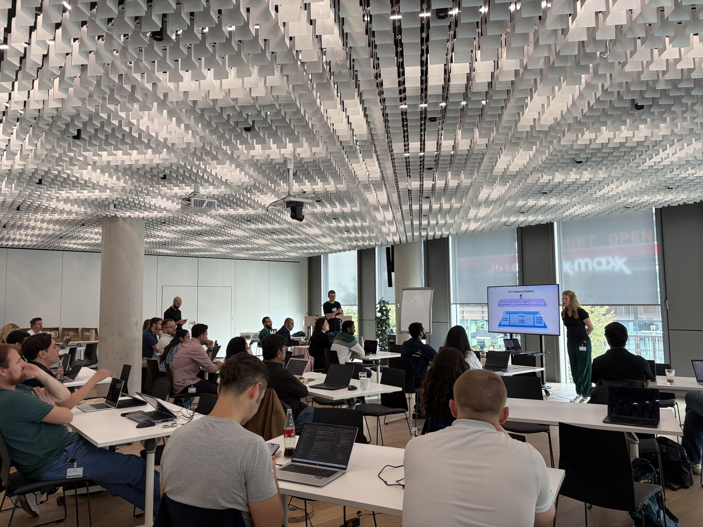
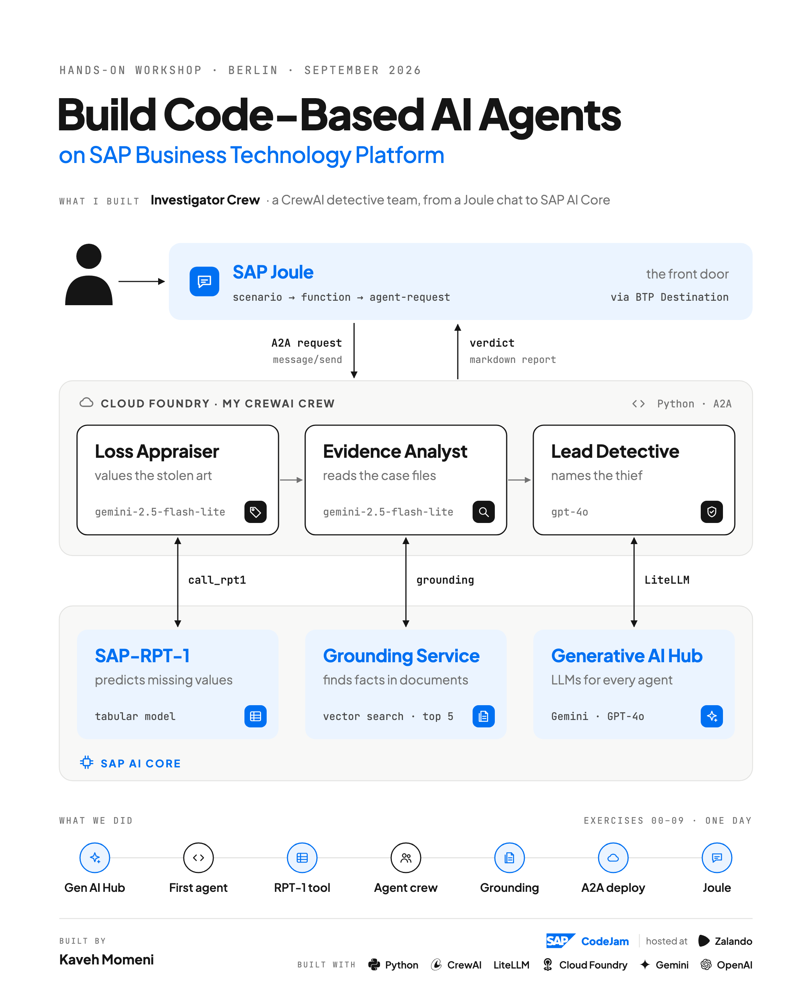

# SAP CodeJam Berlin — LinkedIn Post & Reflections

> **Event:** SAP CodeJam — *Build Code-Based AI Agents on SAP Business Technology Platform*  
> **Location:** Berlin, Germany (Hosted at Zalando)  
> **Instructors:** Witalij Rudnicki & Nora von Thenen  
> **LinkedIn Post:** [https://lnkd.in/p/dFJtP_is](https://lnkd.in/p/dFJtP_is)

---

## Original Post

A few weeks ago I spent a full day in Berlin building AI agents, and I'm still thinking about it.

The SAP CodeJam **"Build Code-Based AI Agents on SAP Business Technology Platform"**, hosted at Zalando, started like a game. A painting worth millions has vanished from a gallery. There are three suspects and a pile of security logs, bank records and phone calls. Our job was to build the detectives.

I built mine in Python with **CrewAI**. The image shows how it all fits together:
- 🔎 an **Evidence Analyst** reads the case files through SAP's **Grounding Service**
- 💰 a **Loss Appraiser** values the stolen art with **SAP-RPT-1**
- 🧠 a **Lead Detective** weighs everything and names the thief

All three think through **Generative AI Hub**. By the end of the day the crew was running on **Cloud Foundry**, talking over **A2A**, and answering from inside **SAP Joule**. The timeline at the bottom of the image is the path we took to get there, one exercise at a time.

It was an intense day, and a few lessons stayed with me:
- → **An agent is only as trustworthy as the data it's forced to use.** *"Never guess"* belongs in every prompt.
- → **A few focused agents work better than one agent that tries to do everything.**
- → **Pick the right model for each job:** RPT-1 for numbers in tables, LLMs for reasoning.
- → **SAP doesn't ask you to give up your framework.** Bring CrewAI or LangGraph, ground it in business data, and let Joule be the front door.

A big thank you to **Witalij Rudnicki** and **Nora von Thenen**. They made complex topics feel approachable, answered every question with real patience, and kept a room full of developers energised through a long, demanding day. You could feel how much they care about this community. Thanks also to **Zalando** for hosting us.

So, who stole the painting? No spoilers. Join a CodeJam and find out 😉

Workshop material: [https://github.com/SAP-samples/codejam-code-based-agents](https://github.com/SAP-samples/codejam-code-based-agents)

`#SAP` `#SAPBTP` `#SAPCodeJam` `#Joule` `#AIAgents` `#GenerativeAI` `#CrewAI` `#SAPDevelopers`

---

## Architecture Infographic

